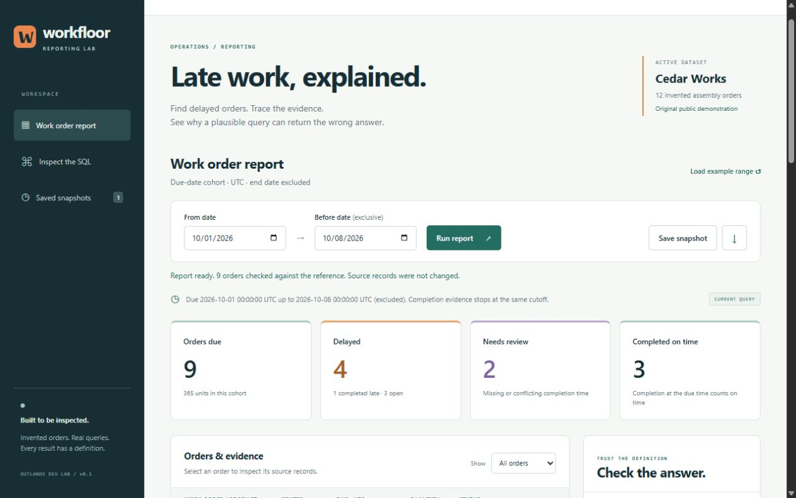

# Workfloor — Manufacturing & SQL Reporting Workbench

**A runnable local prototype using entirely invented manufacturing data.** Choose a due-date range, identify delayed work orders, inspect their completion evidence, and watch validation catch a join that inflates the count.

Built with Python's standard library, SQLite, and plain HTML/CSS/JavaScript. No package installation, account, hosted API, or employer system is needed.

[Download v0.1.0](https://github.com/TheOutlandsDev/workfloor/releases/download/v0.1.0/workfloor-0.1.0.zip) · [Portfolio case study](https://connor-oshea-outlands.thatrobotguy.chatgpt.site/#workfloor) · [Release notes](docs/RELEASE.md)



## Start here

Requires **Python 3.12 or newer** with its standard `sqlite3` module and a modern browser. Tested on Windows 11 with Python 3.12.7 and SQLite 3.45.3. Other platforms are not runtime-qualified in this release.

Extract the ZIP, open a terminal in the extracted project folder, then run:

```console
python app.py
```

On Windows, `start-workfloor.cmd` is an alternative launcher. If port 8765 is occupied, use `python app.py --port 0`; open the exact loopback URL it prints. On a system where Python is named `python3`, use that executable after checking it is version 3.12+.

The first launch creates `data/workfloor.sqlite3` with the invented fixture. Later launches reopen it. Stop with **Ctrl+C**. To choose a separate experiment, use `python app.py --data-dir ./another-demo --port 0`. An existing foreign database is refused rather than reset.

## Reproduce one useful workflow

1. Keep **From date = 2026-10-01**, **Before date = 2026-10-08**. The end date is exclusive; both bounds are UTC midnight.
2. Run the report. Expect **9 orders / 365 units**, **4 delayed** (1 completed late + 3 open at cutoff), **2 needing review**, and **3 completed on time**.
3. Change **Show** to **Delayed**. Inspect `WO-1002`: its identical replay rows remain visible but are collapsed for classification. Inspect `WO-1011` for conflicting timestamps, or `WO-1004` for a missing timestamp.
4. Compare **Correct aggregation** with **Naïve join · wrong**. The correct query matches a separate Python reference. The deliberate error counts **26 joined rows / 1,195 units**, adding 17 rows to the actual 9-order cohort.
5. Save a snapshot. Stop and restart using the same data directory, then open it under **Saved snapshots**. Its results, selected source evidence, parameters, dataset fingerprint and SQL text are preserved.
6. Download the report as JSON if you want a portable result. It is a report export, not a complete database backup.

Try `2026-11-01` to `2026-11-02` for the empty state. Try an end earlier than the start for validation feedback. An empty or sparse range can fail to expose the bad join; the interface says so instead of calling that query correct.

## Who it is for

A developer or reporting reviewer who wants to inspect an operational report's definition, source grain, date boundaries and uncertainty. This example makes one narrow workflow reproducible; it does not forecast production or control equipment.

## Project contribution

Connor O'Shea selected the manufacturing/reporting problem and requested the initial scope: a date-range workflow, parameterized SQL, a deliberate join error, persistent data, and a reproducible handoff. The prototype's code, interface, invented fixtures, tests and documentation were implemented with Codex assistance during this build. The specific reporting policy and tradeoffs are documented for review in [DECISIONS.md](docs/DECISIONS.md).

All orders, products, work centers, process steps and events were invented for this project. This is an original public demonstration, with no employer code, schema, records or operational deployment represented.

## Definition and inspectable SQL

The **grain is one work order**. The cohort contains orders whose due time is at or after the start and strictly before the end. Completion events must occur strictly before that same end cutoff.

| Evidence | Classification |
| --- | --- |
| Earliest usable completion at or before due time | Completed on time |
| Earliest usable completion after due time | Completed late |
| No usable completion before cutoff | Open at cutoff; included in delayed |
| Same source event ID has conflicting timestamps | Needs review; no timing conclusion |
| An undated completion record | Needs review; no timing conclusion |
| No due timestamp | Excluded from due-date cohorts; separately disclosed |

Replay identity is `(order_id, source_event_id)`. Identical copies collapse; different timestamp variants are quarantined from completion selection. A conflict takes precedence over a missing timestamp. Planned steps are illustrative routing rows, not evidence that a step was completed.

- [Schema](sql/schema.sql): three source tables and an append-only-through-the-UI snapshot table.
- [Correct report](sql/report.sql): group source events, reduce evidence to one row per order, then join aggregated process steps.
- [Deliberately wrong query](sql/naive_join.sql): two direct one-to-many joins multiply rows.
- [Procedural reference](workbench.py): Python datetime comparisons and grouping, without reusing the report SQL. Tests also assert a manually specified result table.

Dates are bound separately using named SQLite parameters, following the [Python sqlite3 guidance](https://docs.python.org/3.12/library/sqlite3.html#sqlite3-placeholders). There is no arbitrary SQL execution field.

## Persistence and failure behavior

SQLite stores the synthetic source and saved reports. Saving recomputes the report in a transaction, checks it against the reference, and compares the dataset fingerprint with the version the browser loaded. A changed source returns a conflict and asks for reload; an insert failure rolls back. Existing snapshots remain available. The browser's source inspector does not edit source rows.

Snapshots freeze a report response; the UI offers no update or delete action. A person with local database access can still alter it. The SHA-256 fingerprint identifies the three source tables and is not a signature or authentication mechanism.

For recovery after an interrupted run, restart with the same `--data-dir`. For a database that fails validation, preserve it and use a new data directory for a fresh demonstration. No automatic schema migration or repair is included. If copying a database for your own backup, stop the server first and retain the entire data directory.

## Validation and status

**Local prototype · Windows runtime checked · 21 automated tests passed with no skips.** The browser workflow, JSON download, process restart and saved-snapshot reopening were observed on 26 October 2026. Desktop and phone-width checks use browser emulation, not physical phones.

See [actual validation and limitations](docs/VALIDATION.md), [design decisions](docs/DECISIONS.md), [machine-readable verification](docs/verification.json), and the [example report](examples/default-report.json).

```console
python -m unittest discover -s tests -v
python app.py --demo-report --data-dir ./cli-demo
```

The CLI emits the same JSON report used by the interface. Tests create and remove their own `.test-tmp/case-*` directories inside this checkout. They use synthetic data and actual SQLite/HTTP operations.

## Current limits

This is a single-user, loopback-only local application. It has no MES connection, imports, user accounts, roles, production scheduling, shift calendar, rework/reopening model, partial completion accounting, or schema migration. It is not an official production report or a medical-device tool.

The cutoff is an **event-time view over the current dataset**, not a reconstruction of what was known historically. There is no ingestion-time history. Missing/conflicting evidence is a review case, not proof of a cause, completed quantity, or actual operator activity. The report does not infer capacity or root cause.

Linux/macOS execution, public hosting, multi-user use, accessibility conformance, penetration testing, large datasets, crash/power-loss recovery and long-term maintenance are unqualified. The UI shows up to 50 recent snapshots; older snapshots remain in SQLite. A snapshot is not a backup or a tamper-evident audit log.

License: [MIT](LICENSE). This repository contains the source for the Windows-checked local prototype. The packaged v0.1.0 application matches these runtime files; publication links and release documentation were added afterward. See [release provenance](docs/RELEASE.md).
