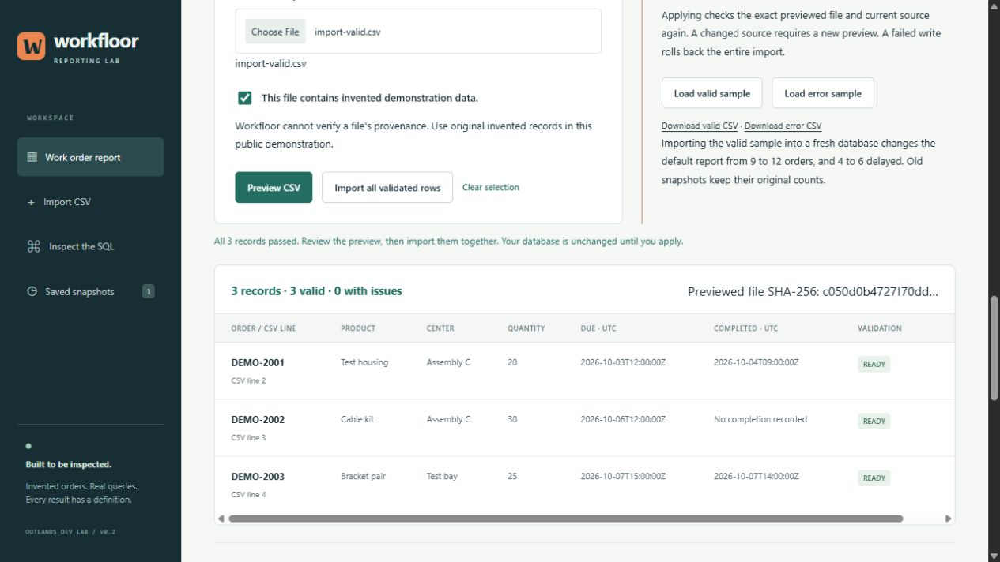
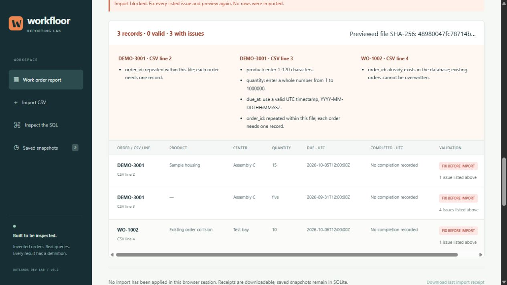

# v0.2 — CSV preview, import and preserved snapshots

This is an original public demonstration using invented records. The file picker sends CSV text only to the local Workfloor server when you select Preview. The application cannot verify a file's provenance.

## Reproduce the workflow

Start with a fresh data directory so the included order IDs do not already exist:

    python app.py --data-dir ./csv-demo --port 0

1. Keep 1 October to 8 October 2026 (exclusive). Save the initial **9-order / 4-delayed** report.
2. Open **Import CSV → Load error sample → Preview CSV**. All three rows have issues; import stays disabled. The preview shows duplicate IDs within the file, a collision with existing `WO-1002`, an invalid calendar date, a missing product and a nonnumeric quantity. No data changes.
3. Select **Load valid sample → Preview CSV**. Review three valid orders. Selecting a file through the file picker also works; it clears any earlier preview and requires confirmation that the data is invented.
4. Select **Import all validated rows**. The current default report becomes **12 orders / 440 units / 6 delayed / 2 needing review / 4 on time**. Two completion events are added. The full source contains 15 orders; three do not enter this due-date cohort.
5. Download the import receipt if you want to retain its file hash, source hashes before/after, added IDs, time and observed default report totals. Receipt downloads are a browser-session feature, not a persistent import-history screen.
6. Open the earlier snapshot. Its **9 orders / 365 units / 4 delayed** and query text remain unchanged. Run the current query again to return to **12 orders / 440 units / 6 delayed**.
7. Restart with the same data directory. Imported orders and both saved snapshots remain in SQLite.

## File contract

[Valid sample](../examples/import-valid.csv) · [Error sample](../examples/import-errors.csv)

The six headers below must each appear exactly once. Their order may differ; spelling and case must match. Use comma-separated UTF-8 CSV, optionally with a UTF-8 BOM. Standard quoted commas and quotes are supported. Blank records are ignored. Multiline field values, control characters and leading/trailing field whitespace are refused rather than silently normalized.

| Header | Rule |
| --- | --- |
| `order_id` | 1–64 uppercase letters, digits, underscores or hyphens; begin with a letter or digit. Must be new in both the file and database. |
| `product` | 1–120 printable characters. |
| `work_center` | 1–80 printable characters. |
| `quantity` | ASCII whole number from 1 to 1,000,000. |
| `due_at` | Required valid UTC timestamp, exactly `YYYY-MM-DDTHH:MM:SSZ`. |
| `completed_at` | The same timestamp format, or empty when no completion is recorded. |

Each import is at most **500 work orders / 256 KiB**. An empty completion field creates no event; it does not create an undated completion. The format adds no routing steps and cannot represent raw event replays, conflicting copies, updates, corrections or deletions. Existing fixture evidence remains inspectable. Text is bound as SQL data and rendered as text in the UI.

## What is preserved

Preview runs a read transaction and returns row-level issues, a CSV SHA-256 and a source fingerprint. It does not write the CSV to disk or modify the database. All rows must pass before Apply is enabled.

The process signs a valid preview's exact CSV hash and source fingerprint. Apply checks that token, obtains a `BEGIN IMMEDIATE` transaction, compares the source fingerprint, reparses/revalidates the entire CSV and inserts new orders and optional completion events with bound parameters. It also checks the default report against the independent Python reference before committing.

A changed file or restarted process invalidates the preview. A changed source returns HTTP 409 and requires another preview. Duplicate IDs are errors; no `REPLACE`, upsert, update, delete, skip-on-error or partial-success path is used. A failure after earlier inserts rolls back the entire batch. Competing applies of the same preview permit only one commit.

Existing source rows and snapshot payloads are retained. v0.2 keeps database format 1 and needs no schema migration. v0.1 snapshot JSON remains readable. The signature binds a preview to a file and source; it does not prove human review, authenticate manufacturing evidence or create a tamper-proof ledger.

Successful imports add records to the selected local database. There is no undo-import UI. Use a separate data directory for independent experiments. A snapshot is a frozen report, not a backup of the database. Import receipts can be downloaded during the current browser session; after reload, snapshots and source data remain, while that session's receipt display resets.

## Observed checks

On Windows 11 with Python 3.12.7 and SQLite 3.45.3, **39 tests passed with no skips**, including the original 21 reporting/HTTP tests and 18 CSV/import tests. These cover read-only preview, mixed-validity rejection, field/header/size limits, duplicate IDs, modified/expired previews, stale source, simultaneous applies, rollback after a later insert fails, old snapshot preservation and HTTP request boundaries.

The actual browser session used the file picker for the valid sample, blocked the error sample, imported three orders, saved a second snapshot, interrupted/restarted the server, and reopened the earlier 9-order snapshot. Both 390- and 320-pixel browser layouts fit their viewport; tables have their own horizontal scroll. This is browser emulation, not physical-phone testing. The interruption returned exit code 1, so it is not graceful-shutdown or power-loss evidence.

The browser receipt-download control was enabled; downloaded receipt bytes were not independently inspected. Backend receipt fields were checked through real HTTP tests. CI runs the backend tests and fresh-database entry-point checks; browser interaction is a separate observed check.
